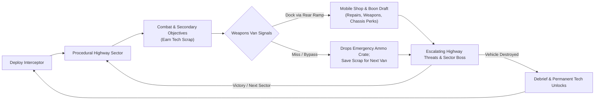
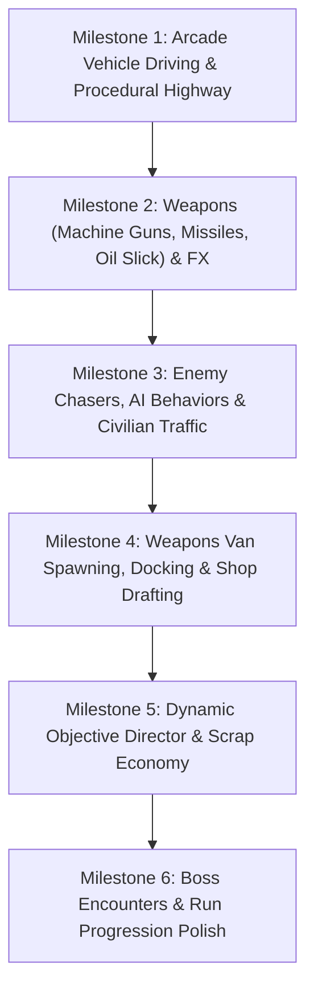

# Game Design Document: Project Interceptor (Working Title)
*A 3D Roguelike Vehicular Combat Game inspired by Spy Hunter (2001)*

---

## 1. Executive Summary & High Concept

* **Genre**: 3D Arcade Vehicular Combat / Roguelike Action
* **Perspective**: Third-person behind-the-car chase camera
* **Engine**: Godot 4 (Jolt Physics, 3D Forward+ / Mobile)
* **Core Pitch**: Fast-paced, arcade-responsive vehicular combat down procedural highways. Players pilot a high-tech interceptor with forward cannons, lock-on missiles, and rear countermeasures. In true *Spy Hunter* fashion, a heavy Weapons Van acts as a dynamic mid-highway mobile shop, where players spend earned Tech Scrap to draft upgrades, repair chassis damage, and expand their arsenal.

---

## 2. Core Pillars & Handling Philosophy

1. **Pure Arcade Responsiveness (Option A Handling)**:
   * **Instant Power Slide**: Tapping the handbrake or hard steering while braking immediately kicks the rear into a snappy, controllable drift.
   * **Counter-Steer & Drift Boost**: Steering through drifts charges a "Drift Nitro" bar; straightening out releases an immediate speed surge.
   * **Forgiving Collisions**: Ramming and scraping guard rails produces sparks and minor speed penalties rather than violent physics flips.
2. **360-Degree Tactical Combat**:
   * **Front**: Twin machine guns (continuous kinetic fire) and lock-on swarm micro-missiles.
   * **Sides**: Lateral rams with heavy kinetic impact multipliers.
   * **Rear**: Defensive countermeasures (oil slicks to send tailgaters spinning, smoke screens to break missile locks, EMP mines).
3. **The Weapons Van as a Moving Roguelike Shop**:
   * Destroying hostile vehicles and completing secondary objectives awards **Tech Scrap** (in-run currency).
   * Docking with the Weapons Van opens a 3-card upgrade shop (weapons, chassis passives, and active countermeasures) plus field armor repairs.
   * **Forgiving Miss Mechanics**: If missed, the van deploys an emergency supply crate before speeding away, preserving the player's currency for the next encounter without ending the run.

---

## 3. The Player Vehicle: The Interceptor

### 3.1 Handling & Physics Profile
* **Chassis Rig**: `CharacterBody3D` with arcade velocity projection, surface normal alignment, and responsive steering curves.
* **Top Speed**: 210 km/h baseline, boosted to 300+ km/h under Nitro.
* **Nitro Boost**: Drains while held, auto-recharges over time, with extra refill granted by drafting behind vehicles or executing clean drifts.
* **Visual Polish**: Procedural body lean/pitch into turns, wheel spin/steer rotations, camera shake on acceleration/boost/impacts.

### 3.2 Vehicle Attributes
* **Armor Integrity**: Structural HP. Depleted by collisions, bullets, and explosions.
* **Overheat / Energy**: Front cannons heat up under sustained firing, rewarding disciplined bursts.
* **Nitro Reserve**: Turbo capacity for evasive escapes and devastating ramming maneuvers.

---

## 4. Weapons & Upgrade Shop Economy

### 4.1 Economy: Tech Scrap
* **Earned By**: Eliminating enemy chasers, destroying convoy drones, completing dynamic sector bounties, and risky driving feats (near-misses, airtime).
* **Spent At**: The Weapons Van on repairs, weapon purchases, and passive perks.

### 4.2 The Weapons Van Sequence
1. **The Signal**: An alert sounds on the HUD: *"ALLIED WEAPONS VAN INCOMING"*.
2. **The Approach**: The armored 18-wheeler merges into traffic ahead with hazard lights flashing and drops its rear boarding ramp.
3. **The Rendezvous**:
   * **Docking Success**: Drive straight onto the ramp. The rear bay doors seal. Time freezes while the HUD displays:
     * *Field Repair*: Restore 35% Armor for Scrap.
     * *Weapon / Mod Cards*: Choose from 3 randomized upgrades (e.g. *Incendiary Rounds*, *Supercharged Boost*, *Shockwave Slick*).
     * Interceptor launches out at maximum speed with brief invulnerability.
   * **Missed Docking**: If the player falls too far behind or crashes, the van signals an abort and jettisons a **Field Supply Crate** (small health/nitro pickup) onto the asphalt. Scrap is kept for the next opportunity.

---

## 5. Procedural Highway Generation

* **Modular Highway Chunks**:
  * Seamless 3D segments instantiated ahead and culled behind.
  * Road varieties: 4-lane superhighways, mountain tunnels, high-speed sweeping bends, bridges with gaps.
  * Dynamic elements: Civilian traffic to weave through, road obstacles, enemy barricades, and oil spills.
* **Multi-Tier Objectives**:
  * **Primary (Required)**: e.g. *Neutralize Syndicate Boss Truck before Sector 3 exit*.
  * **Secondary (Scrap Bounties)**: e.g. *Take zero civilian damage*, *Eliminate 5 escort bikes with rear countermeasures*.
  * **Tertiary (Intel)**: e.g. *Download encrypted data packet from radar outpost along the highway shoulder*.

---

## 6. Implementation Roadmap

